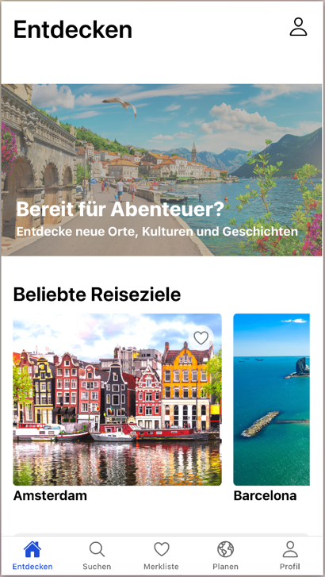
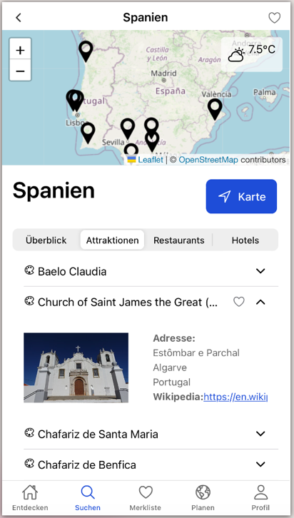
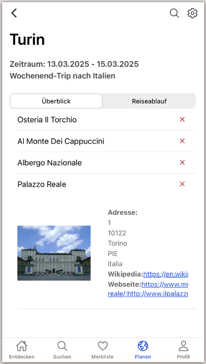
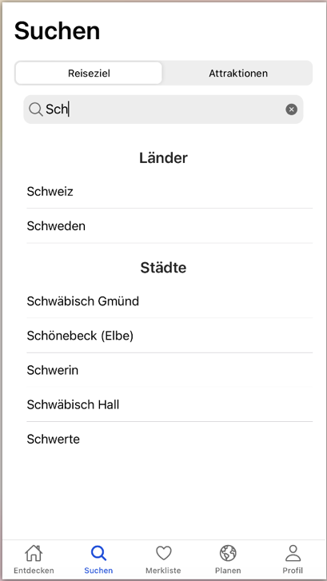
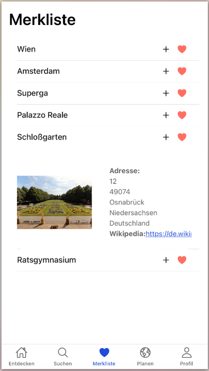
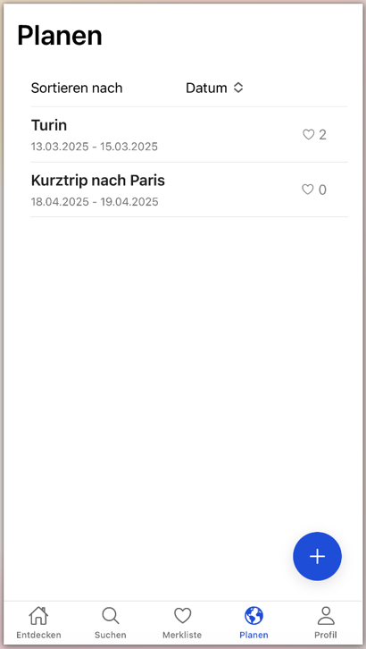
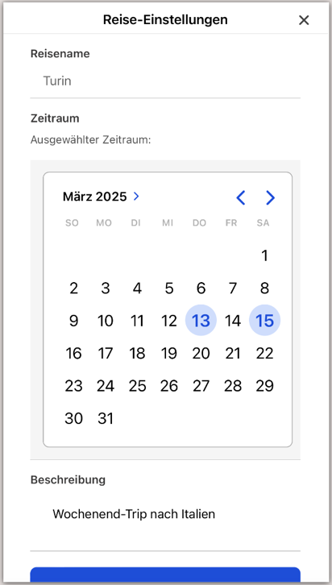

# TripTracker

Mobile Web-App zur Reiseplanung: Sehenswürdigkeiten in der Umgebung entdecken, Reiseziele auf einer
Karte erkunden, Orte auf einer Merkliste sammeln und Reisen Tag für Tag planen.

Studienprojekt im Modul *Webanwendungen* an der Hochschule Osnabrück, allein umgesetzt
(Abgabe Februar 2025).

<table>
  <tr>
    <td></td>
    <td></td>
    <td></td>
  </tr>
  <tr>
    <td align="center">Entdecken</td>
    <td align="center">Ortsdetails mit Karte</td>
    <td align="center">Reiseübersicht</td>
  </tr>
</table>

## Funktionen

- **Entdecken:** beliebte Reiseziele, Suchverlauf und Sehenswürdigkeiten in der Nähe des aktuellen Standorts
- **Suche:** Reiseziele (Länder, Städte) und Attraktionen mit Autovervollständigung
- **Ortsdetails:** interaktive Karte, aktuelles Wetter, Attraktionen, Restaurants und Unterkünfte nach Kategorien
- **Karte:** Umgebung oder Reiseziel erkunden, Orte nach Kategorien filtern
- **Merkliste:** Orte speichern und später einer Reise hinzufügen
- **Reiseplanung:** Reisen anlegen, Zeitraum und Beschreibung festlegen, Orte einzelnen Tagen zuordnen,
  Reisen nach Name, Anzahl der Orte oder Datum sortieren
- **Profil:** Profilbild aus der Fotogalerie, Abmelden, Konto mit allen Daten löschen

<details>
<summary>Weitere Screenshots</summary>

<table>
  <tr>
    <td></td>
    <td></td>
    <td></td>
    <td></td>
  </tr>
  <tr>
    <td align="center">Suche</td>
    <td align="center">Merkliste</td>
    <td align="center">Reiseplanung</td>
    <td align="center">Reise-Einstellungen</td>
  </tr>
</table>
</details>

## Technologien

| Bereich | Eingesetzt |
| --- | --- |
| Frontend | TypeScript, Angular 18, Ionic 8, RxJS |
| Gerätefunktionen | Capacitor (Geolocation, Kamera/Fotogalerie) |
| Backend-Dienste | Firebase Authentication, Cloud Firestore |
| Karten | Leaflet mit OpenStreetMap |
| Externe APIs | [OpenTripMap](https://opentripmap.io) (Sehenswürdigkeiten), [Geoapify](https://www.geoapify.com) (Ortssuche), [WeatherAPI](https://www.weatherapi.com) (Wetter) |
| Werkzeuge | Angular CLI, ESLint |

## Architektur

Die App ist ein reines Frontend. Anmeldung und Datenhaltung übernimmt Firebase, Ortsdaten und
Wetter kommen von externen APIs.

```
src/app/
├── tab1 … tab5/      Hauptseiten (Entdecken, Suche, Planen, Profil, Merkliste)
├── pages/            weitere Seiten (Login, Registrierung, Karte, Orts- und Reisedetails)
├── components/       wiederverwendbare Komponenten und Modals
├── services/         Datenzugriff und API-Anbindung
│   ├── auth.service.ts          Anmeldung, Registrierung, Kontolöschung
│   ├── firestore.service.ts     alle Firestore-Zugriffe
│   ├── opentripmap.service.ts   Sehenswürdigkeiten, inkl. In-Memory-Cache
│   ├── geoapify.service.ts      Ortssuche
│   └── weather.service.ts       Wetter
├── shared/           gemeinsam genutztes Modul
├── guards/           Zugriffsschutz für angemeldete Bereiche
└── model/            Interfaces (Place, Trip, User)
```

### Datenmodell (Firestore)

```
users/{userId}                    Profil (Name, E-Mail, Profilbild, Registrierungsdatum)
users/{userId}/trips/{tripId}     Reisen (Name, Zeitraum, Beschreibung)
users/{userId}/places/{placeId}   gespeicherte Orte mit used_in:
                                    wishlist: true/false
                                    trips: [{ tripName, plannedDates[] }]
```

Ein Ort speichert selbst, ob er auf der Merkliste steht und in welchen Reisen er an welchen Tagen
geplant ist. Firestore kennt keine Joins; so kommt jede Ansicht mit einem Dokument pro Ort aus.
Wird eine Reise umbenannt, passt ein `writeBatch` alle betroffenen Orte gemeinsam an.

## Installation

### Voraussetzungen

- [Node.js](https://nodejs.org) 20 oder 22 (LTS)
- ein eigenes Firebase-Projekt
- kostenlose API-Schlüssel für OpenTripMap, Geoapify und WeatherAPI

### Einrichten

1. Repository klonen und Abhängigkeiten installieren:
   ```bash
   git clone <repository-url>
   cd triptracker
   npm install
   ```
2. In der [Firebase-Konsole](https://console.firebase.google.com):
   - eine Web-App anlegen und die Konfiguration kopieren,
   - unter *Authentication* die Anmeldung per E-Mail/Passwort aktivieren,
   - eine Firestore-Datenbank anlegen und den Inhalt von [`firestore.rules`](firestore.rules) unter *Regeln* veröffentlichen.
3. Konfiguration anlegen:
   ```bash
   cp src/environments/environment.example.ts src/environments/environment.ts
   cp src/environments/environment.example.ts src/environments/environment.prod.ts
   ```
   In beiden Dateien die Firebase-Konfiguration und die API-Schlüssel eintragen,
   in `environment.prod.ts` zusätzlich `production: true` setzen.
   Beide Dateien sind per `.gitignore` vom Repository ausgeschlossen.
4. Starten:
   ```bash
   npm start
   ```
   Die App läuft unter http://localhost:4200. Für die Standortfunktionen den Standortzugriff im Browser erlauben.

### Als Android- oder iOS-App (optional)

Die nativen Projekte sind nicht im Repository enthalten und lassen sich mit Capacitor erzeugen:

```bash
npm run build
npx cap add android   # bzw. ios
npx cap sync
```

Dabei die Berechtigungen für Standort und Fotogalerie ergänzen (Android: `ACCESS_COARSE_LOCATION`,
`ACCESS_FINE_LOCATION`; iOS: `NSLocationWhenInUseUsageDescription`, `NSPhotoLibraryUsageDescription`),
siehe Capacitor-Dokumentation zu [Geolocation](https://capacitorjs.com/docs/apis/geolocation) und
[Camera](https://capacitorjs.com/docs/apis/camera).

## Sicherheit und Datenschutz

- **Firestore Security Rules:** Jeder Nutzer darf nur sein eigenes Dokument `users/{userId}` und
  alles darunter lesen und schreiben. Die Prüfung läuft auf dem Firebase-Server.
- **Nutzer-ID:** wird direkt aus Firebase Auth gelesen, nicht aus dem veränderbaren LocalStorage.
- **Zugangsdaten:** API-Schlüssel und Firebase-Konfiguration liegen in lokalen, nicht versionierten Dateien.
- **Kontolöschung:** Nach erneuter Passworteingabe werden zuerst alle Orte, Reisen und das Profil
  gelöscht, fehlgeschlagene Löschungen wiederholt und das Ergebnis geprüft. Erst danach wird das
  Konto gelöscht. Bleibt etwas übrig, bleibt auch das Konto bestehen und die Löschung kann wiederholt werden.
- **Standort:** wird nur bei Bedarf abgefragt und nicht gespeichert.

## Bekannte Grenzen

- Die API-Schlüssel der externen Dienste sind im ausgelieferten Frontend sichtbar. Sie sollten im
  jeweiligen Anbieterportal auf die eigene Domain beschränkt werden; sauberer wäre ein eigenes
  Backend als Proxy.
- Orte verweisen über den Reisenamen statt über die Reise-ID auf Reisen.
- Die Security Rules prüfen nicht, welche Felder ein Nutzer in seinen eigenen Dokumenten speichert.
- Die vorhandenen Unit-Tests sind die von Angular erzeugten Standardtests.
- Angular 18 wird nicht mehr offiziell unterstützt; ein Update steht aus. `npm audit` meldet für Angular 18
  noch Sicherheitslücken, die erst mit einer neueren Version behoben sind. Sie betreffen Funktionen, die die
  App nicht nutzt (Server-Side Rendering, i18n, XSRF-Schutz für Cookie-basierte Backends).

## Mögliche Erweiterungen

- Reisen gemeinsam mit anderen planen (im ursprünglichen Konzept vorgesehen, nicht umgesetzt)
- Profilbilder in Firebase Storage statt im Nutzerdokument
- Unit-Tests für Services und Datumslogik

## Hinweise zur Entstehung

- Bei der Fehlersuche rund um Firebase und Firestore habe ich KI-Werkzeuge zur Unterstützung genutzt,
  da mir die Datenbank und ihre Methoden zu Beginn wenig vertraut waren.
- Grundlagen aus der Dokumentation von Firebase, Ionic und Leaflet sowie einem Swiper-Tutorial sind
  an den jeweiligen Stellen im Code verlinkt.
